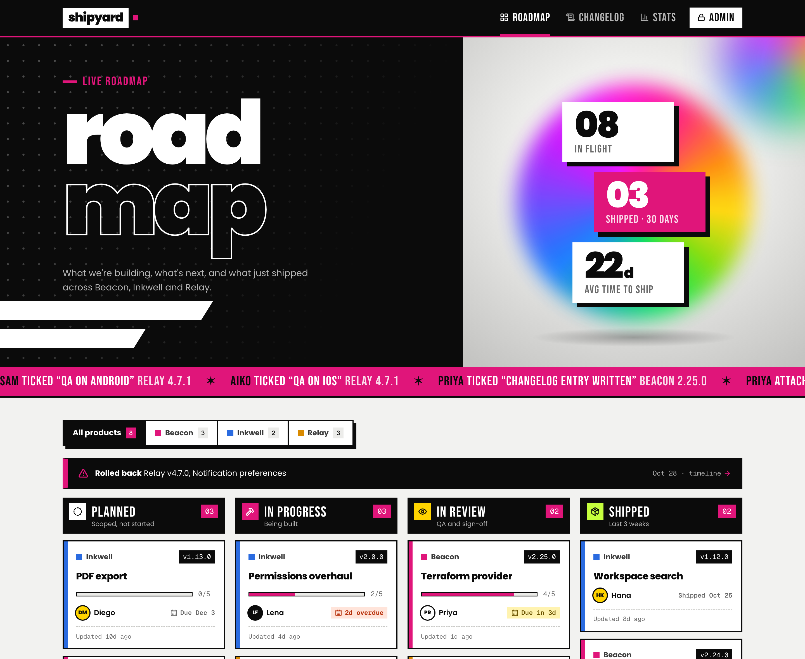
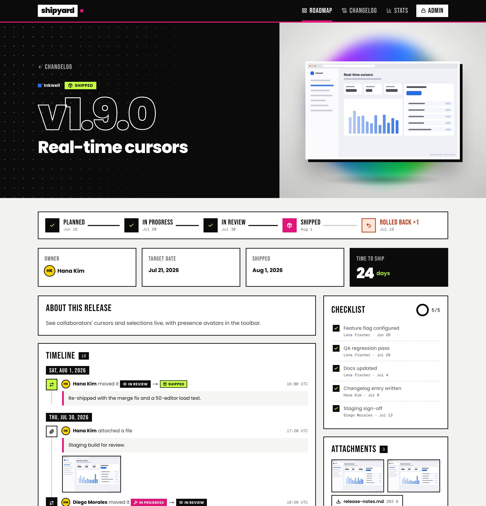
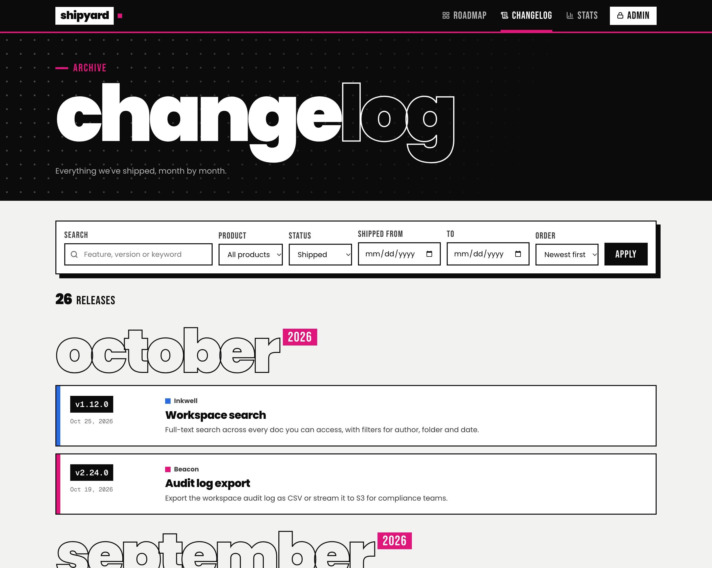
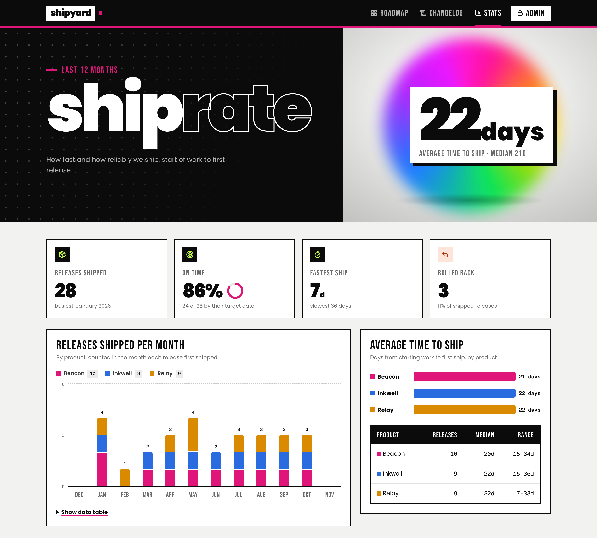
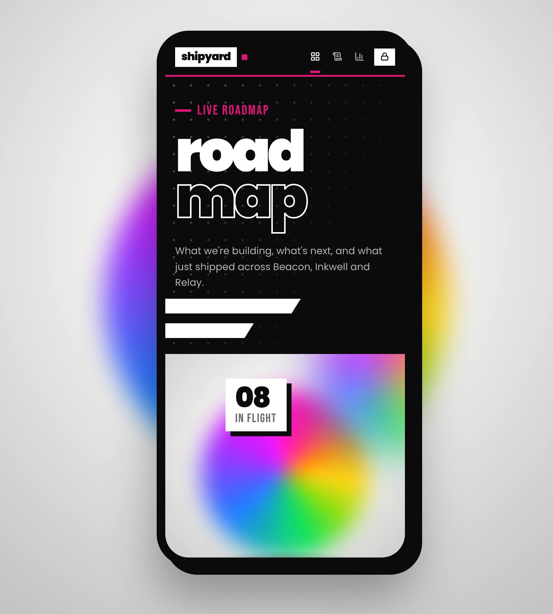

# Shipyard

A release and launch tracker for small software teams, built with Next.js and SQLite.

**Public pages**
- `/` Roadmap: planned, in-progress and in-review releases, plus anything shipped in the last 3 weeks. Recent rollbacks are flagged at the top. Filter by product.
- `/releases/[id]` One release: description, checklist, attachments and its full audit timeline.
- `/changelog` Everything shipped, grouped by month. Search by keyword or version; filter by product, shipped/rolled back, and date range.
- `/stats` Releases shipped per month (stacked by product), average time to ship, on-time rate and rollbacks. Every chart has hover tooltips and a data-table view.

**Admin** (`/admin`): sign in with your name and the team password. Create releases (product, version, description, owner, target date, checklist, screenshots and attachments), then move them through statuses, tick checklist items, reassign, reschedule, comment and attach files.



<details>
<summary>More screenshots</summary>

**Release page with audit timeline**



**Changelog archive**



**Stats**



**Mobile**



</details>

## Design

The UI borrows the language of motion-graphics showreels:
- **Panels:** black/white split panels on a studio-grey backdrop, with halftone dot grids and slanted bars.
- **Type:** heavy geometric type (Poppins 800/900) with outlined lettering, plus condensed captions (Bebas Neue).
- **Numbers:** white "price tag" boxes with hard shadows.
- **Accents:** hot magenta, with lime for shipped.
- **Motion:** slowly spinning iridescent orbs, a live activity marquee and staggered reveals. All of it is CSS-only and switched off under `prefers-reduced-motion`.

Product colours (magenta, blue, amber) are validated as a colour-blind-safe categorical set, and every chart has a data-table view.

## Statuses

```
PLANNED → IN PROGRESS → IN REVIEW → SHIPPED → ROLLED BACK
             ↑   ↓          ↓                     │
          PLANNED      IN PROGRESS ←──────────────┘
```

- Shipping requires every checklist item to be ticked, unless you tick “ship anyway”. The log then records how many items were open.
- A rollback requires a reason.
- The checklist locks once a release ships. It reopens after a rollback.

## The audit log is immutable

Every change is a new row in `release_events`. Each row is stamped with the time, the signed-in person's name and a snapshot of the status, owner and target date that applied after it. Current state is derived from the log (the `release_state` and `checklist_state` views). Nothing is stored as a mutable field.

SQLite triggers reject `UPDATE` and `DELETE` on every table (products, releases, checklist items, events, files). History can only be appended to, even by someone with direct database access through the app's connection. Corrections are made by adding a new entry.

## Run locally

Requires Node 20+.

```bash
npm install
npm run dev        # http://localhost:3000
```

The first request creates `data/shipyard.db` and seeds three fictional products (Beacon, Inkwell, Relay) with about a year of history: 36 releases and roughly 360 audit entries. The admin password is `admin` in development unless `ADMIN_PASSWORD` is set.

```bash
npm run db:seed    # wipe and re-seed the demo data
```

## Deploy to Vercel

Vercel's filesystem is read-only and ephemeral, so a SQLite file can't persist there. Shipyard uses **libSQL**, which reads the same SQLite file locally and connects to hosted SQLite ([Turso](https://turso.tech)) in production, with no code changes.

1. `turso db create shipyard`, then get the URL (`turso db show --url shipyard`) and a token (`turso db tokens create shipyard`).
2. Optional: seed it with `TURSO_DATABASE_URL=… TURSO_AUTH_TOKEN=… npm run db:seed`. Otherwise the schema is created on first request, empty.
3. Import the repo into Vercel and set these environment variables:
   - `TURSO_DATABASE_URL` and `TURSO_AUTH_TOKEN`
   - `ADMIN_PASSWORD` (required: admin is disabled in production without it)
   - `ADMIN_SECRET` (a long random string for signing session cookies)

Without Turso, a Vercel deployment still runs as a demo on `/tmp`, re-seeded on each cold start, and the admin dashboard warns that changes won't persist.

## Attachments

Files are stored in the database and served from `/api/files/[id]` with immutable caching. Uploads are identified by their content, not the browser's claimed type: PNG, JPEG, WebP, GIF, PDF, ZIP, and UTF-8 text (`.txt .md .log .csv .json`). The limit is 8 files and 4 MB per upload, which stays under Vercel's request limit. Images display inline; every other file type downloads.

## Layout

```
src/lib/db.ts           schema, append-only triggers, state views, connection
src/lib/releases.ts     queries + transition rules (createRelease, recordChange)
src/lib/seed.ts         3 fictional products, ~a year of release history
src/lib/palette.ts      product colors (validated colour-blind-safe categorical set)
src/lib/stats.ts        shared time-to-ship maths (roadmap hero + stats page)
src/lib/auth.ts         team password + signed session carrying the actor's name
src/proxy.ts            redirects unauthenticated /admin requests
src/components/Charts.tsx  stacked columns and bar chart with tooltips
src/app/…               pages and server actions
```

All products, people and releases in the seed data are fictional.
